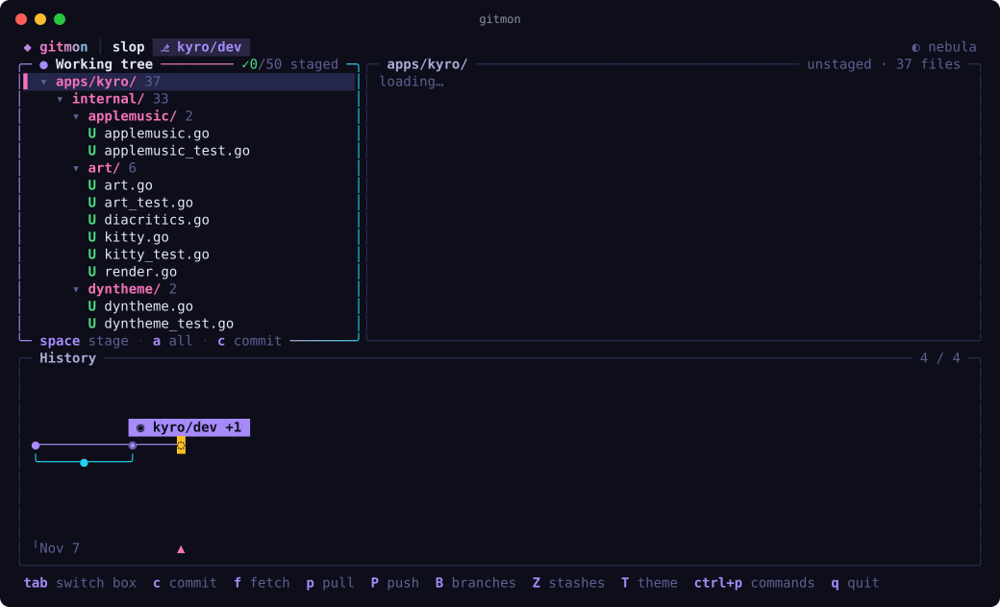
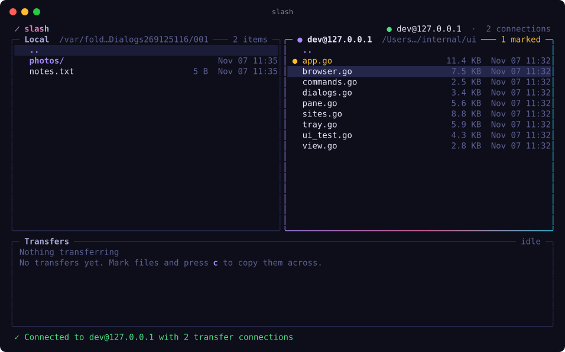

# slop

Terminal apps that share one design language. Go monorepo: apps in `apps/`, shared kernel in `pkg/`.

| App | What it is |
| --- | --- |
| [**gitmon**](apps/gitmon) | A themeable git TUI with a horizontal commit graph. Like lazygit. |
| [**slash**](apps/slash) | A two-pane SFTP client with parallel transfers. Like WinSCP. |

<p align="center"> </p>

## Install

```sh
curl --proto '=https' --tlsv1.2 -sSf https://raw.githubusercontent.com/karim-w/slop/main/install.sh | sh
```

This asks which apps you want. To pick one without the prompt:

```sh
curl --proto '=https' --tlsv1.2 -sSf https://raw.githubusercontent.com/karim-w/slop/main/install.sh | sh -s -- gitmon
```

Binaries go to `~/.local/bin`. Change that with `--dir`, install everything with `--all`, or build from source with `--source` (needs Go). Run `sh install.sh --help` for every option.

From a checkout: `make install APP=gitmon`.

## Develop

```sh
make            # build every app into ./bin
make run APP=slash
make check      # gofmt, vet and tests across every module
make new-app NAME=foo   # scaffold apps/foo on the shared packages
make help
```

```
apps/      one folder per app; each is its own Go module with private internals
pkg/       the shared kernel (see pkg/README.md)
  domain/  shared models: themes, build info
  infra/   paths, config files, logging, keychain
  utils/   text shaping, humanised numbers, maths
  tui/     the declarative TUI framework (see pkg/tui/README.md)
tools/     build helpers (SVG screenshots)
```

Releases: push a `v*` tag and CI publishes macOS and Linux binaries that the installer picks up.
