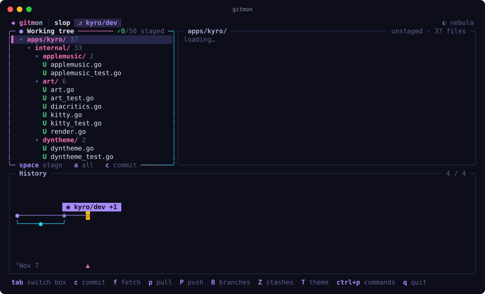

# gitmon

A themeable git TUI built on Charm's v2 stack (Bubble Tea, Lip Gloss, Bubbles, Huh and Harmonica) and the shared [`pkg/tui`](../../pkg/tui) design language.



## Install

```sh
curl --proto '=https' --tlsv1.2 -sSf https://raw.githubusercontent.com/karim-w/slop/main/install.sh | sh -s -- gitmon
```

From a checkout, run `make install APP=gitmon`, or `make run APP=gitmon ARGS=path/to/repo` to try it.

```
gitmon [path]            open the repo at path (default: .)
gitmon --theme nord      use a theme for this run
gitmon --themes          list themes
gitmon --dump-theme X    print theme X as JSON
gitmon --version
```

```
╭─ Working tree ─────────╮╭─ Diff / Editor ──────────────────────╮
│ STAGED 2               ││ @@ -1,3 +1,4 @@                      │
│▌ M parser.go           ││   1  1  feat: add parser             │
│ CHANGES 1              ││      2 +handle empty input           │
│  U notes.txt           ││                                      │
╰────────────────────────╯╰──────────────────────────────────────╯
╭─ History ──────────────────────────────────────────────────────╮
│            feature/graph   hotfix   ◉ main                     │
│ ●──●──●──●──────────◆──●─────◆──◉──────────◌                   │
│       ╰──┼──●──●──╯  ╰──┼──────●──●──●                         │
│          ╰───────────●──╯                                      │
│ ╵Nov 6                    ▲                                    │
╰────────────────────────────────────────────────────────────────╯
```

## Layout

- **Working tree** (top left, focused at start). Every changed file once, grouped by folder. Staged rows are highlighted green with a `✓`, and partly staged ones get a `◐`. `space` stages or unstages the selected file or folder, and folders stay open or folded as you left them. `→` opens a folder and `←` folds it (or jumps to the parent). `a` stages everything, `d` discards unstaged changes, `c` commits and `A` amends. A selected folder shows the combined diff of everything in it. `v` switches to a flat list and back, and gitmon remembers your choice.
- **Diff / Editor** (top right). The diff for the selected file. `n`/`N` jump between hunks, `space` stages or unstages a hunk and `d` discards it. `e` opens the file in an editor inside the box (`ctrl+s` saves). `E` opens it in `$EDITOR` instead.
- **History** (bottom). A horizontal commit graph with the oldest commit on the left and the newest on the right.
  - `←`/`→` move between commits and `↑`/`↓` jump between lanes.
  - The selected commit shows a tooltip with the author's initials and name, when it was committed, its hash, its refs and its message.
  - `⏎` opens a floating window with the commit's changed files and their diffs. Inside it, `[`/`]` move to the previous or next commit.

`tab` cycles between the three boxes. `1`, `2` and `3` jump straight to one. `B` opens branches, `Z` opens stashes, `ctrl+p` opens the command palette and `T` opens the theme picker.

## Committing

`c` commits and `A` amends. How it works depends on the `commit` setting in `~/.config/gitmon/config.json`:

- `"inline"` (default): a small box opens. Type the message (the first line is the summary) and press `⏎` to commit. `ctrl+j` adds a new line, `ctrl+e` moves your draft into your editor, and `esc` cancels.
- `"editor"`: gitmon hands the terminal to `git commit`, which opens the editor git is set up with (`GIT_EDITOR`, `core.editor`, `VISUAL` or `EDITOR`), like lazygit. Save and quit to commit, or quit with an empty message to cancel.

```json
{ "commit": "editor" }
```

You can also switch it from the palette with "Setting: commit with editor / message box".

## Rex integration

Inside Rex, gitmon takes on Rex's theme. At startup it asks the terminal for its colours: background, foreground and the 16 ANSI colours (OSC 10, 11 and 4). It builds its theme from those colours and never repaints the terminal background. It asks again on focus and every 2 seconds, so when you change the theme in Rex, gitmon follows within a couple of seconds.

The same mode works in other terminals that answer these colour queries. Run `--theme terminal` to use it there.

To switch back to Rex's theme after picking a built-in one, pick `rex (live)` in `T`, or run "Sync theme from rex" in the palette.

## Themes

In Rex the default is `rex` (live). Elsewhere it is `nebula`. The other built-in themes are `catppuccin-mocha`, `tokyo-night`, `rose-pine`, `kanagawa`, `gruvbox`, `nord`, `dracula`, `everforest`, `synthwave`, `catppuccin-latte` and `paper`.

You can add your own theme as a JSON file in `~/.config/gitmon/themes/*.json`. Run `gitmon --dump-theme nebula` to print one to use as a starting point.

## Debugging

`GITMON_LOG=debug gitmon` writes a log to `~/.local/state/gitmon/gitmon.log`.

## Code

```
main.go            flags and startup
internal/config    ~/.config/gitmon/config.json
internal/git       runs git and parses its output
internal/graph     lays out the horizontal commit graph
internal/ui        the Bubble Tea model and keys, with views declared in pkg/tui
```

Themes, panels, springs, terminal colour sync and text helpers come from [`pkg/`](../../pkg).

`TestScreens` builds a fixture repo and checks every main screen and dialog. To print frames for a repo of your own:

```
GITMON_DEMO=/path/to/repo go test ./internal/ui -run TestSnapshot -v
GITMON_DEMO=. KEYS="tab,|,B" SIZE=100x30 go test ./internal/ui -run TestSnapshot -v
```
