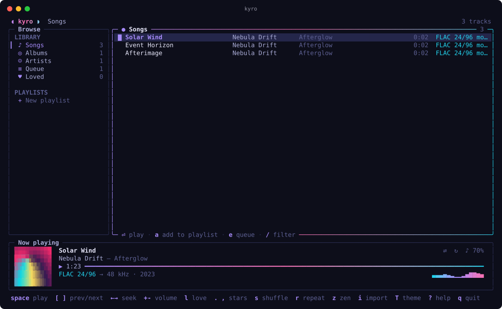
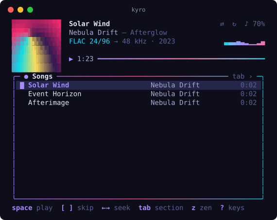
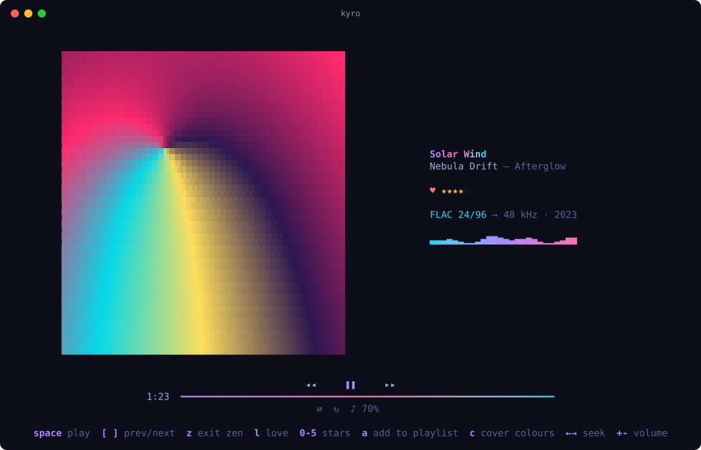
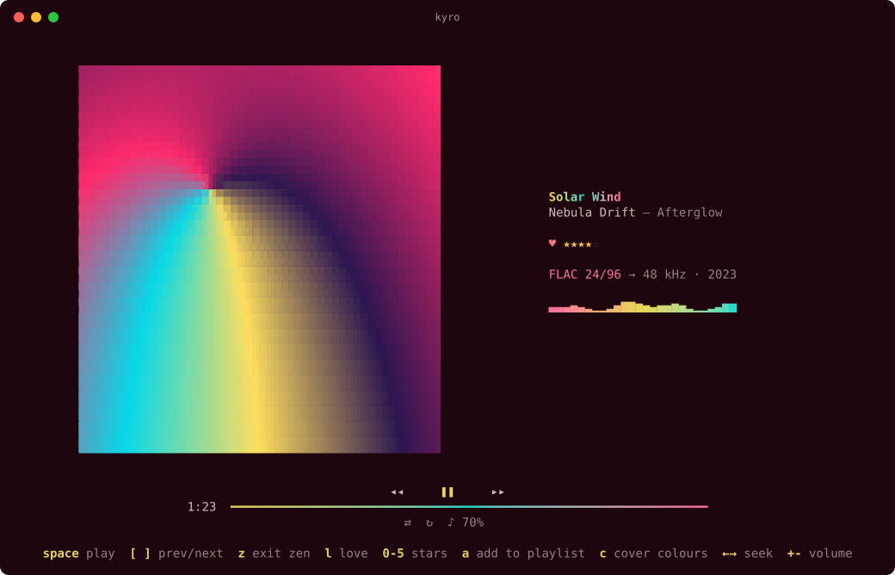

# kyro

A music player for the terminal. Your library stays where it is: kyro remembers where each file lives and never copies it. Playlists are plain `.m3u8` files you can take to iTunes and your iPod. Cover art is drawn in colour, other programs can follow what's playing, and the layout fits anything from a full window to a small tiling pane.



<p> </p>

## Install

```sh
curl --proto '=https' --tlsv1.2 -sSf https://raw.githubusercontent.com/karim-w/slop/main/install.sh | sh -s -- kyro
brew install mpv        # kyro plays audio through mpv (apt/dnf/pacman install mpv on Linux)
kyro import ~/Music     # index a folder (repeat for more sources)
kyro                    # play
```

`kyro doctor` checks the setup.

## Layouts

kyro picks a layout for the space it gets, so it can live in a corner of a tiling setup such as herdr or tmux:

| Size | Layout |
| --- | --- |
| a window (≥ 96×24) | sidebar (songs, albums, artists, queue, playlists), track table, now-playing bar |
| a pane (≥ 40×9) | now-playing card with art, and the list below; `tab` switches section |
| a sliver | one line: track, time and a seek bar |
| `z`, any size | **zen**: large cover art, the song, artist and album, controls and keys |

## Keys

| Key | Action |
| --- | --- |
| `space` | play / pause |
| `]` `[` | next / previous (previous restarts the track after 3s) |
| `←` `→`, `⇧←` `⇧→` | seek 5s, 30s |
| `+` `-` | volume |
| `s`, `r` | shuffle, repeat (off → all → one) |
| `⏎` | play from here, or open an album or artist |
| `/` | filter the list |
| `e`, `E` | add to the queue, play next |
| `1`–`5`, `tab` | songs, albums, artists, queue, loved; switch sidebar or section |
| `a`, `A` | add the track, or the whole list, to a playlist |
| `N`, `R`, `D`, `X` | new, rename, delete, export a playlist |
| `x`, `J` `K` | remove a playlist track, move it down / up |
| `i`, `ctrl+r` | import a folder, file or `.m3u8`; rescan |
| `l` | love / unlove |
| `.` `,` | one star more / fewer (`0`–`5` in zen mode) |
| `5` | your loved songs |
| `c` | theme from the cover, on / off |
| `m` | sound mode: pure, punch, wide, deep (plays live as you move) |
| `z`, `T`, `C`, `?`, `q` | zen, themes, cover art style, help, quit |

## Where things live

Everything is in `~/.kyro` (or `$KYRO_HOME`):

```
config.json        settings, sources, hooks
library.json       the index: paths and tags, never the audio itself
playlists/*.m3u8   your playlists
ratings.json       loves and stars, by file path (survives rescans)
hooks/             executables run on playback events
themes/*.json      extra themes
now-playing.json   the current track, rewritten on every change
cache/art/         covers exported for hooks
```

Removing a source (`kyro sources rm PATH`) only forgets it; your files are untouched. Tracks whose file disappears are kept and marked missing, and a source on an unplugged drive is left alone.

## Loves and stars

Press `l` to love a song and `.` / `,` to give it more or fewer stars, from 0 to 5. In zen mode, `0`–`5` set the stars directly and `a` adds the playing song to a playlist. While browsing, these keys apply to the selected song; in zen mode and from the sidebar, to the one playing. Loved songs collect under **♥ Loved** (`5`).

The same works from outside: `kyro ctl love` toggles love on the playing song, and `kyro ctl rate 4` sets its stars. Hooks receive `KYRO_LOVED` and `KYRO_STARS`.

**Apple Music:** on macOS, loves and stars are copied into the Music app (Apple calls loving a song "favoriting" it), so they reach your iPhone and iPod too:

- **Matching:** tracks match by file. Songs Music manages, such as `~/Music/Music/Media.localized`, sync. Songs Music doesn't know are skipped.
- **When it syncs:** by default (`"appleMusic": "auto"`) kyro only syncs while Music is open, and never opens it for you. Changes made while Music is closed wait and catch up later.
- **Other settings:** `"always"` opens Music when needed, and `"off"` turns syncing off.
- **Commands:** `kyro music pull` copies your existing Music loves and stars into kyro (kyro changes not yet synced win). `kyro music push` sends kyro's waiting changes to Music. `kyro music status` shows what's waiting.
- **Permission:** the first time, macOS asks whether your terminal may control Music.

## Playlists, iTunes and the iPod

A playlist is an extended M3U file with absolute paths:

```
#EXTM3U
#PLAYLIST:Night Drive
#EXTINF:245,Nebula Drift - Solar Wind
/Users/you/Music/Nebula Drift/Afterglow/01 Solar Wind.flac
```

To move one to iTunes / Music, use `X` in kyro, or `kyro playlist export "Night Drive" ~/Desktop`. Then in Music choose **File › Library › Import Playlist…** and sync to your iPod as usual. The iPod plays MP3, AAC and ALAC but not FLAC, so convert FLAC files first. In the other direction, `kyro import mix.m3u8` brings a playlist in, resolving relative paths.

## Hooks: telling other programs what's playing

kyro announces four events: `track` (a song started), `pause`, `resume` and `stop`. For each event:

- **Executables in `~/.kyro/hooks/`** named after the event run. An executable named `event` runs for all of them.
- **Commands in `config.json`** run too:

  ```json
  "hooks": [
    { "event": "track", "command": "terminal-notifier -title \"$KYRO_TITLE\" -message \"$KYRO_ARTIST\" -contentImage \"$KYRO_ART\"" },
    { "event": "*", "command": "sketchybar --trigger kyro_changed" }
  ]
  ```

- **What a hook receives:** the full event as JSON on stdin, plus `KYRO_EVENT`, `KYRO_TITLE`, `KYRO_ARTIST`, `KYRO_ALBUM`, `KYRO_PATH`, `KYRO_ART` (an image file), `KYRO_DURATION`, `KYRO_QUALITY`, `KYRO_POSITION` and `KYRO_VOLUME`.
- **Hooks never hold up the music.** They run in the background with a 10-second limit. When you skip quickly, an older run of the same hook is cancelled, so hooks only ever see the latest track.
- **`~/.kyro/now-playing.json`** is always current, for anything that polls a file.

## Remote control

A running kyro listens on `~/.kyro/kyro.sock`. Only your user can use it. This is how window-manager key bindings, media keys and status bars drive kyro:

```sh
kyro ctl toggle | play | pause | next | prev | stop | shuffle | repeat
kyro ctl seek +10        # or -10, or an absolute 90
kyro ctl volume -5       # or +5, or 40
kyro ctl sound wide      # or pure, punch, deep; no name moves to the next
kyro status              # ▶ Solar Wind — Nebula Drift  (1:23 / 4:56)
kyro status --format '{{.Artist}} – {{.Title}}'
kyro status --json
kyro listen              # one JSON line per event, for long-running widgets
```

The protocol is one JSON object per line (`{"cmd":"next"}`, `{"cmd":"subscribe"}`), so any language can speak it.

## Sound quality and safety

kyro decodes through [mpv](https://mpv.io), which plays every format kyro indexes at full resolution: MP3, AAC, ALAC, FLAC, WAV, AIFF, Opus, Vorbis, WavPack, Monkey's Audio, DSD, AC-3, E-AC-3 and TrueHD, at any bit depth, sample rate and channel count. The now-playing line shows the source and what your device actually gets, such as `FLAC 24/96 → 48 kHz`, so you can see when the system resamples.

The defaults are the safe ones, and they treat your sound card like any other media player:

- **Shared mode:** audio goes through the OS mixer (CoreAudio, PipeWire/PulseAudio).
- **Surround:** `"channels": "auto-safe"` plays surround only when the device reports it accepts it, and downmixes otherwise.
- **Volume:** capped at 100%, with no software amplification.
- **Your mpv settings:** kyro ignores your own mpv config and scripts.
- **Crashes:** if kyro crashes, mpv stops with it. Nothing keeps playing in the background.

### Sound modes

By default kyro plays the file exactly as mastered. Press `m` to choose a sound mode. The song switches as you move through the list, so you can compare them on the music you're playing; `⏎` keeps one and `esc` goes back.

| Mode | What it does | Best on |
| --- | --- | --- |
| **pure** | nothing: the file as mastered | good headphones, DACs, careful listening |
| **punch** | +3 dB sub weight (60 Hz), +4 dB kick body (120 Hz), a little attack (3 kHz) and air (10 kHz) | anything |
| **wide** | punch with the bass moved up to 90–150 Hz, where laptop woofers can play it, plus a wider stereo stage that keeps vocals in the centre | MacBook speakers |
| **deep** | a big low shelf (+6 dB under 80 Hz) and sub-bass at 45 Hz | headphones and external speakers |

On an M1 Pro's built-in speakers, try **wide**. Apple Music sounds bigger by default because its **Sound Enhancer** setting widens and brightens the music. **wide** is kyro's answer, and you can turn it off.

How the modes stay safe for speakers, ears and drops:

- **Headroom first:** each mode lowers the level by 3–5 dB before boosting.
- **A limiter last:** peaks are held at -1 dBFS, so the output is never louder than a normal loud master. A test renders every mode from a full-scale signal and checks this.
- **No compression:** nothing squashes the music as a whole, so drops keep their impact.
- **Same limits as before:** the volume cap of 100, shared mode and the OS mixer still apply. Your Mac's own speaker protection works as usual.

The choice is saved as `"sound"` under `audio` in `config.json`. `wide` mixes surround down to stereo; the other modes keep every channel.

### Other settings

Settings you can opt into in `config.json`, under `audio`:

| Setting | What it does |
| --- | --- |
| `"device"` | pick an output (`kyro devices` lists them) |
| `"channels": "auto"` | send every channel to a multichannel interface |
| `"exclusive": true` | bit-perfect output on macOS; other apps go silent meanwhile |
| `"passthrough": ["ac3","eac3","dts","truehd"]` | send Dolby and DTS untouched to an HDMI or S/PDIF receiver. Only enable this if your receiver decodes those formats. |
| `"replaygain": "album"` | loudness normalisation |

## Cover art

Covers come from the file's embedded picture, or from `cover.jpg`, `folder.jpg` or `front.png` in its folder. How they're drawn depends on the terminal:

| Style | Detail | Where |
| --- | --- | --- |
| **pixels** | the real image, at full resolution | terminals with the kitty graphics protocol: Rex, kitty, Ghostty, WezTerm |
| **sextant** | 2×3 pixels per cell | fonts with Unicode 13 sextant glyphs |
| **quadrant** | 2×2 pixels per cell | almost every modern font |
| **halfblock** | 1×2 pixels per cell | anywhere |
| **ascii** | coloured characters from a 70-step density ramp | anywhere |
| **ascii-mono** | plain characters in your text colour, the classic look | anywhere |

- **Choosing a style:** press `C` to choose. The cover behind the dialog previews each style as you move, `⏎` keeps one and `esc` goes back. The choice is saved as `"art"` in `config.json`. The default, `auto`, asks the terminal at start and uses real pixels when it can, quadrant blocks otherwise.
- **How pixels work:** kyro scales the cover once per size to match the terminal's cell size, at 2× for sharp HiDPI screens. It sends the image once, then shows it through the protocol's Unicode placeholder cells, so it moves, resizes and sits under dialogs like any text. Images are freed when kyro exits.
- **How the block styles work:** each cell gets the two colours that best fit its pixels, and scaling averages in linear light so colours stay true.
- **How the ASCII styles work:** each cell gets a character by brightness, stretched to the cover's own range so dark covers still use every step.
- **Tracks without art** get a soft generated cover in your theme's colours.

## Themes

kyro uses the same themes as the other slop apps. Press `T` to preview them live. Choose **terminal** to follow your terminal's colours (the default inside Rex, updated as Rex's theme changes), or add your own in `~/.kyro/themes/*.json` (`gitmon --dump-theme nebula` prints a starting point).

### Theme from the cover

Press `c` (or choose **cover** under `T`) and the whole theme comes from the cover of the song that's playing: the background, text, accents, gradients, borders and the selected row. It fades to the next cover's colours when the song changes, and suits zen mode best.



- **How it picks:** kyro finds the cover's main colours. The largest one, darkened, becomes the background; a mostly light cover gives a light theme. The most vivid colours that stand out from it become the accents.
- **Readable on every cover:** text and accents are adjusted until they have at least 4.5:1 contrast with the background. Success, warning and error keep their usual hues.
- **Saved:** the setting is `"dynamic_theme": true` in `config.json`, so it stays on across restarts.
- **Without a cover:** with nothing playing, or a song without art, your normal theme shows.
- **Terminal background:** kyro sets the terminal's background to the cover's while this is on, and gives it back when you turn it off or quit.

## Code

```
main.go            CLI: the player, import, scan, ctl, status, listen, playlists, doctor
internal/home      ~/.kyro layout and config.json
internal/library   the index: scanning, tags, header probes (rate, depth, channels, duration)
internal/playlist  .m3u8 files
internal/engine    the playback engine interface and the mpv backend
internal/player    queue, shuffle, repeat and gapless hand-off
internal/art       finding covers and drawing them in the terminal
internal/dyntheme  a whole theme derived from a cover
internal/sound     sound modes: the filter chains mpv runs
internal/hooks     hook executables, config hooks and now-playing.json
internal/ipc       the control socket
internal/ratings   loves and stars (ratings.json)
internal/applemusic syncing them with the macOS Music app
internal/ui        the Bubble Tea model and views on pkg/tui
```

`go test ./...` runs everything. The engine tests use the real mpv with `--ao=null`, so they never open a sound device, and they skip when mpv is missing. `KYRO_LOG=debug kyro` logs to `~/.kyro/kyro.log`.
