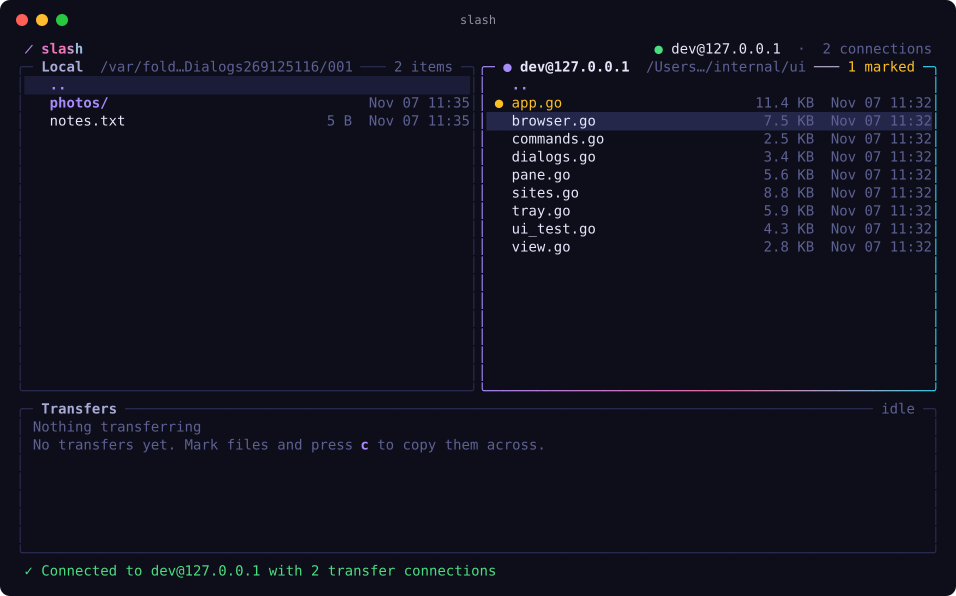

# slash

A two-pane SFTP client for the terminal. Local files are on the left, the server is on the right, and a transfer tray at the bottom shows live progress. It uses the shared [`pkg/tui`](../../pkg/tui) design language, so it looks and themes like the other slop apps.



## Install

```sh
curl --proto '=https' --tlsv1.2 -sSf https://raw.githubusercontent.com/karim-w/slop/main/install.sh | sh -s -- slash
```

From a checkout, run `make install APP=slash` or `make run APP=slash`.

```
slash                     start with the site manager
slash --theme tokyo-night use a built-in theme (or set SLASH_THEME)
slash --theme terminal    follow the terminal's colours (the default inside Rex)
slash --themes            list themes
slash --version
```

## Features

- **Dual-pane browser**: mark files, copy them across, rename, delete, make folders, filter.
- **Parallel transfers**: each site opens N extra SSH connections (default 4, max 16).
  Files are spread across them, and files over 32 MiB are split into chunks so a
  single large file also uses every connection.
- **Transfer tray**: overall progress, speed and ETA, plus per-file progress. Cancel,
  retry and clear finished transfers.
- **Saved sites**: stored in `~/Library/Application Support/slash/sites.json` on macOS
  and `~/.config/slash/sites.json` on Linux. The slash file never holds passwords.
- **Remember password (optional)**: you can turn this on per site. The password is
  saved in the OS keychain (macOS Keychain, Secret Service, Windows Credential Manager).
- **Authentication**: slash tries ssh-agent, then your private key (or `~/.ssh/id_*`),
  then the password. The password also unlocks encrypted keys.
- **Host key checking** uses `~/.ssh/known_hosts`. You confirm unknown hosts by their
  fingerprint. If a host key changes, slash refuses to connect.

## Keys

| Key | Action |
| --- | --- |
| `tab` | switch between local, remote and the tray |
| `enter` / `backspace` | open folder / go up |
| `space`, `a` | mark one file, or mark all |
| `c` / `F5` | copy the selection to the other pane |
| `n` `r` `d` | new folder, rename, delete |
| `/`, `.` | filter, show hidden files |
| `t` | expand or collapse the tray |
| `s`, `ctrl+d` | open the site manager, disconnect |
| `?` | show all keys |

## Code

```
main.go                 flags and startup
internal/config         saved sites (JSON) and keychain passwords
internal/session        SSH dialling, auth, known_hosts and the connection pool
internal/vfs            one FileSystem interface for local disk and SFTP
internal/transfer       queue, chunking, workers and progress
internal/ui             the Bubble Tea model, with views declared in pkg/tui
internal/sftptest       an in-process SFTP server for tests
cmd/devserver           runs that server locally so you can try the app
```

## Development

```
go test -race ./...
go run ./cmd/devserver          # 127.0.0.1:2222, user dev, password dev
SLASH_LOG=debug slash           # logs to ~/.local/state/slash/slash.log
```

`internal/ui/ui_test.go` drives the whole UI against the in-process server: it connects, trusts the host key, enters the password, browses and opens dialogs.
